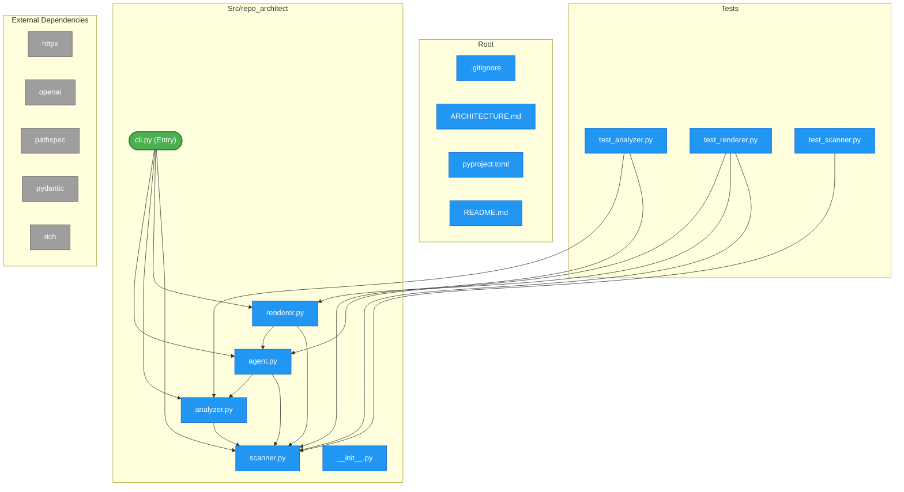

# Architecture Overview: Repo-Arch

> **Local-First Codebase Architecture Analysis**  
> *Local-first codebase architecture and structural overview.*  
> Generated: 2026-11-24 18:39:06 • **100% Local Execution**

---

## 1. Executive Summary

Repo-Arch is organized into 3 primary subsystem(s) encompassing 13 source module(s) and 15 internal dependency links. The architecture maintains strict separation of concerns with privacy-first local processing.

### Architectural Principles & Highlights
- Privacy-Preserving Architecture: Operates entirely offline with zero cloud telemetry.
- Modular Subsystem Partitioning: Clear separation between ingestion, parsing, synthesis, and rendering.
- Dependency Health: 6 external third-party package dependency footprint.

## 2. High-Level System Flowchart

## 3. Core Subsystems & Components

| Component | Description | Key Files |
| :--- | :--- | :--- |
| **Root** | Subsystem managing 4 module(s) within the 'root' domain. | `.gitignore` `ARCHITECTURE.md` `README.md` *(+1 more)* |
| **Src** | Subsystem managing 6 module(s) within the 'src' domain. | `src/repo_architect/__init__.py` `src/repo_architect/agent.py` `src/repo_architect/analyzer.py` *(+3 more)* |
| **Tests** | Subsystem managing 3 module(s) within the 'tests' domain. | `tests/test_analyzer.py` `tests/test_renderer.py` `tests/test_scanner.py` |

### Component Details & Responsibilities
#### Root
Subsystem managing 4 module(s) within the 'root' domain.

**Responsibilities:**
- Provides core domain functionality for root

**Associated Files:** `.gitignore`, `ARCHITECTURE.md`, `README.md`, `pyproject.toml`

#### Src
Subsystem managing 6 module(s) within the 'src' domain.

**Responsibilities:**
- Serves as system entry point and user interaction handler
- Provides core domain functionality for src
- Implements key classes: ComponentInfo, ArchitectureAnalysis, ArchitectureAgent, ImportRelation

**Associated Files:** `src/repo_architect/__init__.py`, `src/repo_architect/agent.py`, `src/repo_architect/analyzer.py`, `src/repo_architect/cli.py`, `src/repo_architect/renderer.py`, `src/repo_architect/scanner.py`

#### Tests
Subsystem managing 3 module(s) within the 'tests' domain.

**Responsibilities:**
- Automated verification and unit test suite

**Associated Files:** `tests/test_analyzer.py`, `tests/test_renderer.py`, `tests/test_scanner.py`

## 4. System Entry Points

- `src/repo_architect/cli.py` (main_block) - Command Line Interface for Repo-Architect.

## 5. Primary Data & Execution Flows

- 1. Invocation & Initialization: User or script invokes entry point
- 2. Static Ingestion: Filesystem traversal and static code metadata extraction
- 3. Internal Dependency Linking: Module imports and relationships mapped
- 4. Architecture Synthesis: Structural summarization and Mermaid flowchart construction
- 5. Document Rendering: Validated ARCHITECTURE.md generated for developer consumption

## 6. Privacy Guard & Security Verification

- **Zero External Egress:** Analysis generated via deterministic static AST heuristics (Local LLM (http://localhost:11434/v1, model=qwen2.5-coder) unavailable or returned error: Connection error.). Strictly local execution verified.
- **Files Visited:** 14
- **Files Indexed:** 13
- **Files Excluded (Strict Guard & .gitignore):** 5
- **Masked Secrets:** 11
- **Exclusion Breakdown:** strict_dir: 4, strict_file_pattern: 1

---
*Report generated locally by [Repo-Architect](https://github.com/)*
