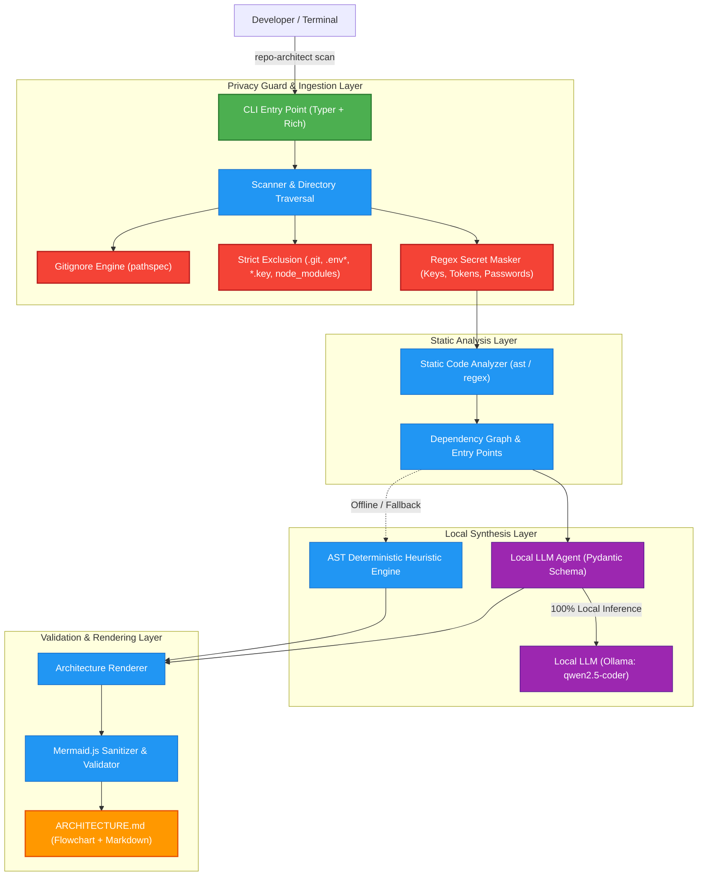

# Repo-Architect

[](https://www.python.org/downloads/)
[](#1-core-architectural--privacy-constraints)
[](https://typer.tiangolo.com/)
[](https://mermaid.js.org/)
[](LICENSE)

A **local-first**, **privacy-focused** CLI tool written in Python that analyzes a local codebase and generates an architectural overview along with a strictly valid Mermaid.js flowchart (`ARCHITECTURE.md`).

---

## 1. Core Architectural & Privacy Constraints

Repo-Architect is built from the ground up for teams and developers working in air-gapped, proprietary, or privacy-critical environments:

* 🛡️ **100% Local Execution:** No source code or metadata is ever sent to external cloud APIs. All LLM interactions strictly target a local OpenAI-compatible endpoint or Ollama (`http://localhost:11434/v1` by default, configurable via `.env` or flags).
* 🔒 **Strict File Exclusion (Privacy Guard):** Never reads or indexes:
  * VCS directories: `.git/`, `.svn/`, `.hg/`
  * Secrets & configs: `.env*`, `*.pem`, `*.key`, `*.crt`, `*.pfx`, `id_rsa*`
  * Package managers & virtualenvs: `node_modules/`, `.venv/`, `venv/`, `__pycache__/`
  * Target repository `.gitignore` patterns (parsed recursively using `pathspec`).
* 🧹 **Secret Sanitization:** Lightweight regex filters mask API keys (`sk-...`, `ghp_...`, `AKIA...`), tokens, passwords, database URIs, and private key headers before code summaries reach the local model.
* 🧩 **Modular Structure:** Concerns are cleanly decoupled into standalone, single-responsibility modules.
* ⚡ **Zero-LLM Offline Heuristic Fallback:** If Ollama is offline or unreachable, Repo-Architect seamlessly falls back to deterministic AST dependency clustering to render a complete, valid architecture document without failure.

---

## 2. Architecture & Data Flow



---

## 3. Project Directory Structure

```text
repo-architect/
├── src/
│   └── repo_architect/
│       ├── __init__.py      # Package metadata & exports
│       ├── cli.py           # Typer + Rich CLI entry point (`repo-architect scan <path>`)
│       ├── scanner.py       # Traversal, .gitignore parsing, privacy exclusions, secret masking
│       ├── analyzer.py      # Static AST extraction of entry points, modules, and import graphs
│       ├── agent.py         # Local LLM client with structured output (Pydantic) & heuristic fallback
│       └── renderer.py      # Validates Mermaid syntax and renders final ARCHITECTURE.md
├── tests/
│   ├── test_scanner.py      # Unit tests verifying .env, .git, and secret masking rules
│   ├── test_analyzer.py     # Unit tests for dependency/import extraction & entry points
│   └── test_renderer.py     # Unit tests for Mermaid validation and markdown generation
├── .env.example             # Example local configuration (LLM_BASE_URL, LLM_MODEL)
├── .gitignore               # Strict exclusion rules
├── pyproject.toml           # Packaging & dependencies (typer, rich, pydantic, openai, pathspec, pytest)
└── README.md                # Documentation and architecture guide
```

---

## 4. Installation

### Requirements
- Python 3.9 or higher
- Optional: [Ollama](https://ollama.com/) or any OpenAI-compatible local LLM server (e.g. LM Studio, vLLM, LocalAI)

### Setup
```bash
# Clone the repository
git clone https://github.com/batu0labs/RepoArch
cd repo-architect

# Install in editable mode
pip install -e .

# Or install with dev dependencies
pip install -e ".[dev]"
```

Verify installation:
```bash
repo-architect --version
```

---

## 5. Configuration

Copy `.env.example` to `.env` or set environment variables:

```bash
cp .env.example .env
```

| Variable | Default Value | Description |
| :--- | :--- | :--- |
| `LLM_BASE_URL` | `http://localhost:11434/v1` | URL of your local Ollama or OpenAI-compatible server |
| `LLM_MODEL` | `qwen2.5-coder` | Target model name in local server |
| `LLM_API_KEY` | `ollama` | API key (Ollama accepts any dummy string) |
| `LLM_TIMEOUT` | `90` | Timeout in seconds for model inference |

> [!TIP]
> If you have Ollama installed, pull a code model like:
> ```bash
> ollama pull qwen2.5-coder
> ```

---

## 6. Usage Guide

### Basic Scan
Scan the current directory and generate `ARCHITECTURE.md`:
```bash
repo-architect scan .
```

### Scan a Specific Repository
```bash
repo-architect scan /path/to/my-project
```

### Custom Output File
```bash
repo-architect scan /path/to/my-project --output /path/to/my-project/DOCS_ARCHITECTURE.md
```

### Pure Offline Mode (Zero LLM Required)
Run pure deterministic static analysis without querying any LLM:
```bash
repo-architect scan . --offline
```

### Override Local Model or Endpoint
```bash
repo-architect scan . --model llama3.2 --base-url http://localhost:11434/v1
```

### Verbose Mode
Display detailed logs of scanned files, excluded paths, and masked secrets:
```bash
repo-architect scan . -v
```

---

## 7. How It Works (Module Breakdown)

### `scanner.py` (Privacy Guard & Secret Masking)
- **Directory Exclusions:** Prunes directories matching `.git`, `node_modules`, `.venv`, `__pycache__`, etc., before traversing their children.
- **File Pattern Exclusions:** Drops `.env*`, `*.pem`, `*.key`, `*.crt`, `credentials.json`, etc.
- **Gitignore Engine:** Parses the repository `.gitignore` using `pathspec` to mirror git's behavior.
- **Secret Sanitization:** Replaces keys matching OpenAI (`sk-...`), GitHub (`ghp_...`), AWS (`AKIA...`), Slack tokens, JWTs, private key headers, and generic passwords with `[REDACTED_...]` placeholders.

### `analyzer.py` (Static AST Code Extraction)
- **AST Parser:** Parses Python source trees safely without executing untrusted code.
- **Dependency Topology:** Extracts `import` and `from ... import` statements, cleanly distinguishing internal repo modules from Python standard library (`os`, `sys`, `pathlib`) and third-party packages (`typer`, `pydantic`).
- **Entry Point Detection:** Identifies `if __name__ == '__main__':` blocks, Typer commands (`@app.command()`), Click commands, and FastAPI endpoints.
- **Polyglot Fallback:** Lightweight regex parsing for JavaScript/TypeScript, Go, and Rust.

### `agent.py` (Local LLM Synthesis & Fallback)
- **Structured Pydantic Model:** Enforces a rigid schema (`ArchitectureAnalysis`) containing project overview, component breakdowns, data flow steps, and Mermaid flowcharts.
- **100% Local OpenAI Client:** Targets `http://localhost:11434/v1` with zero cloud egress.
- **Deterministic Heuristic Engine:** If Ollama is offline or times out, creates a complete architectural model directly from the AST graph, ensuring the CLI never crashes.

### `renderer.py` (Mermaid Validation & Document Formatting)
- **Mermaid Sanitizer:** Ensures valid flowchart headers (`flowchart TD`), quotes all node bracket labels (`node["Label"]`), strips unsupported HTML tags, and ensures balanced subgraphs.
- **Markdown Builder:** Generates an `ARCHITECTURE.md` file complete with badges, executive summary, component tables, entry point lists, and privacy verification reports.

---

## 8. Verification & Testing

Repo-Architect includes a complete unit test suite covering privacy exclusions, secret masking, AST dependency parsing, entry point detection, and Mermaid sanitization:

```bash
pytest -v
```

All tests run in standard sandbox mode with zero external network access.

---

## 9. Privacy Verification Report Sample

Every generated `ARCHITECTURE.md` includes an automated audit verification:

```markdown
## 6. Privacy Guard & Security Verification

- **Zero External Egress:** 100% Local Execution. All analysis performed locally without cloud transmission.
- **Files Visited:** 13
- **Files Indexed:** 12
- **Files Excluded (Strict Guard & .gitignore):** 4
- **Masked Secrets:** 11
- **Exclusion Breakdown:** strict_dir: 3, strict_file_pattern: 1
```

---

## License

Distributed under the MIT License. See [pyproject.toml](pyproject.toml) for details.
